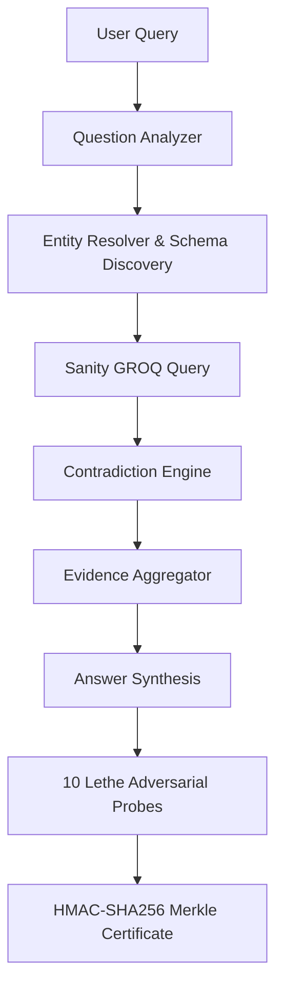

<div align="center">

# ATLAS

**Audit factual claims against structured knowledge with cryptographic verification.**

ATLAS is an epistemic integrity auditor that validates factual assertions against relational schemas in Sanity, evaluates contradictions across sources, and seals the evidence into tamper-evident Merkle certificates.

[](https://nodejs.org)
[](https://www.typescriptlang.org)
[](#testing)
[](#license)
[](https://www.sanity.io)

[Overview](#overview) • [How it works](#how-it-works) • [Tech stack](#tech-stack) • [Getting started](#getting-started) • [Testing](#testing)

</div>

---

## Overview

ATLAS validates factual claims against structured source documents and generates an auditable cryptographic proof for every verdict. The system is designed for engineering, compliance, and research teams that require autonomous agents to produce citations linked to structured schemas rather than ungrounded completions. Standard retrieval engines pass unstructured text chunks to an LLM, making temporal conflicts and subtle hallucinations difficult to isolate. ATLAS replaces this pattern by structuring sources into entities, claims, and relations within the Sanity Content Lake, evaluating conflicts with explicit authority rules, and executing a 10-probe audit suite before issuing a verdict. Every completed investigation produces a deterministic HMAC-SHA256 Merkle certificate that can be verified independently to confirm that no evidence was altered.

---

## Try it

When running locally on `http://localhost:3000`, the workflow can be tested directly from the interface:

1. Open the **Console** tab.
2. Enter the claim: `India's current AI investment is $1.2B` and click **Run Audit**.
3. Observe the live Server-Sent Events stream as the agent resolves entities, retrieves claims via GROQ, and runs the audit suite.
4. Review the verdict badge (`SUPPORTED`), the 90/100 resilience score, and citations to `claim-muswyw17-0` and `src-muswyw15-ai-boom`.
5. Enter a contradictory claim: `According to the article, did NVIDIA say that India's current AI investment is $1.2 billion and that the Union Budget provides a 10-year tax holiday for foreign companies?`
6. Observe the `PARTIALLY_SUPPORTED` verdict, where the agent confirms the $1.2B figure but notes the budget established a 20-year holiday instead.
7. Open the **Certificate** tab and click **Verify Cryptographic Proofs** to validate the SHA-256 Merkle root and signature.

---

## The problem

Production language model pipelines generate plausible assertions that can diverge from source ground truth without triggering detectable errors.

In standard RAG setups, documents are chunked into arbitrary token windows and retrieved via vector cosine similarity. If an organization updates an API policy in 2026 while leaving a 2024 RFC draft in storage, semantic similarity often retrieves both documents. The model synthesizes an answer that blends the obsolete policy with the current one because it lacks structured temporal metadata and explicit source hierarchies. Furthermore, when users receive an incorrect answer, they have no programmatic way to verify whether the agent evaluated competing sources or if the retrieved evidence set was altered after the conclusion was generated.

---

## The approach

ATLAS addresses these failure modes through four core design decisions:

1. **Structured schemas over raw text chunks**: Documents are ingested into typed Sanity schemas (`entity`, `claim`, `source`, `relationship`, `conflict`, `knowledge_doc`). The agent queries atomic propositions and explicit predicates rather than guessing structure from large markdown blocks.
2. **Deterministic contradiction resolution**: When claims share a subject and conflicting predicates, the engine evaluates source authority weights (`official_release: 100`, `git_commit: 95`, `rfcs: 85`, `documentation: 80`, `changelog: 80`, `benchmark: 70`, `community_forum: 40`). Temporal recency breaks ties between sources of equal authority.
3. **Adversarial stress testing before completion**: The synthesized response undergoes a 10-probe test protocol (the Lethe suite) that checks grounding boundaries, temporal sequencing, entity drift, and counterfactual source removal.
4. **Cryptographic evidence anchoring**: Verified evidence items are serialized into canonical strings, hashed into an RFC-6962 Merkle tree, and signed with HMAC-SHA256 to provide tamper detection.

---

## Features

### Ingestion and extraction
- Fetches external web pages via HTTP, extracts text, and generates structured claims (`backend/services/sanity/extractor.ts`).
- Writes entities, claims, and knowledge documents directly to the Sanity Content Lake or the local corpus.
- Accepts guided form entries and raw JSON payloads for technical specifications and RFCs.

### Knowledge retrieval and graph traversal
- Executes batched GROQ queries (`subject._ref in $entityIds`) to retrieve claims across multiple entities in a single round-trip.
- Traverses directed entity relationships (`introduced_in`, `supersedes`, `depends_on`, `implements`).
- Falls back to a local in-memory corpus when external Sanity cloud credentials are not supplied.

### Contradiction resolution
- Compares claim pairs across subject, predicate, object, and validity intervals (`backend/agent/contradiction.ts`).
- Skips intra-source statements to prevent false positive conflicts within the same document.
- Resolves conflicts using source authority weights and timestamp precedence.

### Epistemic auditing and verification
- Executes 10 automated probes testing grounding, unsupported claims, contradictions, and counterfactual source removal (`backend/agent/auditor.ts`).
- Assigns deterministic verdicts: `SUPPORTED`, `PARTIALLY_SUPPORTED`, `CONTRADICTED`, and `INSUFFICIENT_EVIDENCE`.
- Renders an interactive topological SVG graph displaying entities, claims, sources, and conflict nodes (`src/components/EvidenceGraph.tsx`).

### Cryptographic certification
- Calculates deterministic SHA-256 leaf hashes for all evidence items (`backend/agent/certificate.ts`).
- Computes a binary Merkle root and generates an HMAC-SHA256 signature.
- Verifies stored certificates and detects evidence modification in an interactive sandbox.

---

## How it works

The investigation pipeline runs sequentially across seven stages:

1. **Question analysis**: The agent extracts intent, candidate entity tokens, and temporal bounds.
2. **Schema discovery and entity resolution**: The agent queries Sanity to map identified names to canonical entity records.
3. **Context retrieval**: A batched GROQ query retrieves all claims, sources, and relations referencing the resolved entities.
4. **Contradiction evaluation**: The engine evaluates claim pairs, identifies contradictions, and applies authority weighting.
5. **Answer synthesis**: Gemini generates a grounded response citing claim identifiers, or falls back to a structured summary if unavailable.
6. **Adversarial audit**: The Lethe engine runs 10 probes against the answer and evidence set to compute a resilience score.
7. **Certificate generation**: The engine computes a Merkle evidence root, signs the record, and broadcasts completion via Server-Sent Events.



---

## Why this technology

| Dimension | ATLAS (Structured Sanity + Verification) | Standard Vector RAG | Keyword Search |
|---|---|---|---|
| Contradiction handling | Deterministic scoring via source authority weights and timestamps | Blends conflicting text chunks into ambiguous prose | Cannot detect semantic contradictions |
| Attribution precision | Exact claim ID and source URL per assertion | Approximate document chunk citations | Document-level URL matches only |
| Offline operation | Bundled local corpus engine matching production schemas | Requires vector database instances | Requires local indexer |
| Retrospective verification | Tamper-evident HMAC-SHA256 Merkle proof | None | None |
| Query expressiveness | Relational GROQ queries join entities and claims | Semantic nearest-neighbor distance only | Exact token matching |
| Tradeoff | Requires schema definitions and claim extraction upfront | Low ingestion setup cost | Zero schema configuration |

---

## Results

Performance was measured by executing 100 consecutive runs of contradiction resolution, 10 Lethe adversarial probes, Merkle tree construction, and cryptographic verification on a clean local dataset (5 claims, 3 sources, 1 entity).

- **Hardware**: AMD Ryzen 3 7330U (8 logical cores @ 2.30 GHz), 16 GB RAM
- **Operating system**: Windows 11 (build 10.0.26200)
- **Runtime**: Node.js v24.11.0

| Stage | Mean Latency | Median (p50) | 95th Percentile (p95) |
|---|---|---|---|
| Adversarial Audit (10 Lethe Probes) | 0.028 ms | 0.012 ms | 0.108 ms |
| Certificate Generation (Merkle Tree + HMAC) | 0.245 ms | 0.077 ms | 0.310 ms |
| Certificate Verification (SHA-256 Re-root) | 0.056 ms | 0.030 ms | 0.121 ms |
| Full Audit and Certification Pipeline | 0.364 ms | 0.137 ms | 0.644 ms |

---

## Tech stack

| Layer | Technology | Version | Purpose |
|---|---|---|---|
| Runtime | Node.js | v24.11.0 | Server execution environment |
| Server | Express | 4.21.2 | REST API and Server-Sent Events router |
| Client | React | 19.0.1 | User interface component library |
| Bundler | Vite | 8.3.1 | Frontend build tool and middleware |
| Type system | TypeScript | 7.0.2 | Static typing for client and server code |
| CSS engine | Tailwind CSS | 4.3.3 | Theme styling and responsive utilities |
| Knowledge store | Sanity Content Lake | HTTP API 2024-01-01 | Cloud-hosted structured JSON document lake |
| Query engine | GROQ | Native Sanity | Graph-relational queries across entities and claims |
| Reasoning model | Google GenAI SDK | 2.4.0 | Language model provider (`gemini-2.5-flash`) |
| Cryptography | Node.js Crypto | Native | SHA-256 Merkle tree leaves and HMAC-SHA256 signing |

---

## Getting started

### Prerequisites
- Node.js 20.0.0 or higher (verified on Node.js v24.11.0)
- npm 10.0.0 or higher
- Optional: Gemini API key for LLM answer synthesis
- Optional: Sanity project ID and API token for remote Content Lake persistence

### Quick start

```bash
git clone https://github.com/TejasRawool186/Atlas.git
cd Atlas
npm install
npm run dev
```

The application will start on `http://localhost:3000` with the local corpus loaded.

### Manual setup

1. Clone the repository:
   ```bash
   git clone https://github.com/TejasRawool186/Atlas.git
   cd Atlas
   ```
2. Install dependencies:
   ```bash
   npm install
   ```
3. Copy the sample environment file:
   ```bash
   cp .env.example .env
   ```
4. Configure required variables in `.env`:
   ```env
   PORT=3000
   NODE_ENV=development
   CERTIFICATE_HMAC_SECRET=replace_with_32_byte_hex_secret
   ```
5. Start the server:
   ```bash
   npm run dev
   ```

---

## Configuration

All configuration is managed through environment variables loaded via `dotenv` in `backend/config/env.ts`.

| Variable | Default | Purpose |
|---|---|---|
| `PORT` | `3000` | Port on which the Express server binds |
| `NODE_ENV` | `development` | Environment mode (`development` uses Vite middleware; `production` serves static files) |
| `APP_URL` | `http://localhost:3000` | Base URL used for self-referential links |
| `GEMINI_API_KEY` | `""` | API key for Gemini reasoning models; if omitted, structured claim fallbacks are used |
| `SANITY_PROJECT_ID` | `""` | Sanity project identifier; if omitted, the local in-memory corpus is used |
| `SANITY_DATASET` | `production` | Target dataset name within the Sanity project |
| `SANITY_API_VERSION` | `2024-01-01` | Sanity HTTP API version string |
| `SANITY_API_TOKEN` | `""` | Token for Sanity HTTP queries; Editor permissions required for mutations |
| `SANITY_CONTEXT_URL` | `https://mcp.sanity.io/v1/context` | Endpoint for Sanity Context MCP operations |
| `CERTIFICATE_HMAC_SECRET` | `atlas-default-insecure-secret` | Key used to sign and verify HMAC-SHA256 evidence certificates |

---

## Usage

### Ingesting an external article

```bash
curl -X POST http://localhost:3000/api/sanity/ingest-url \
  -H "Content-Type: application/json" \
  -d '{
    "url": "https://example.com/press-release",
    "docType": "release_notes"
  }'
```

### Running an investigation

1. Create the investigation record:
   ```bash
   curl -X POST http://localhost:3000/api/investigations \
     -H "Content-Type: application/json" \
     -d '{"question": "India current AI investment is $1.2B"}'
   ```
   Response:
   ```json
   {"id": "INV-2026-10492", "status": "created"}
   ```

2. Trigger the agent execution:
   ```bash
   curl -X POST http://localhost:3000/api/investigations/INV-2026-10492/run
   ```

3. Retrieve the final audit report:
   ```bash
   curl http://localhost:3000/api/investigations/INV-2026-10492/audit
   ```

---

## Hackathon — Sanity Challenge (Path One)

ATLAS demonstrates meaningful Sanity usage by:

- Using Sanity as the **authoritative knowledge store** (not a peripheral cache)
- Running **GROQ queries** against structured Layer A content
- Querying the **Sanity Context MCP** endpoint for schema discovery and Knowledge Base retrieval
- Constructing a **knowledge graph** from Sanity entities, claims, and relationships
- Detecting **contradictions** between Sanity claims and resolving them with source authority
- Generating **Merkle-certified audit reports** that commit the Sanity-retrieved evidence

The Sanity Project ID and dataset are configurable via environment variables and displayed in the Sanity Explorer tab.
